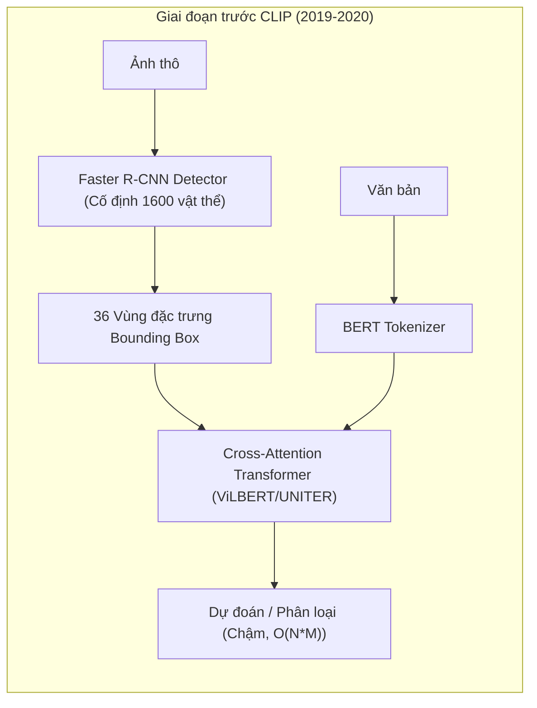
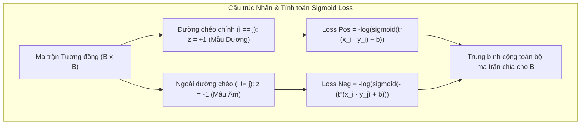
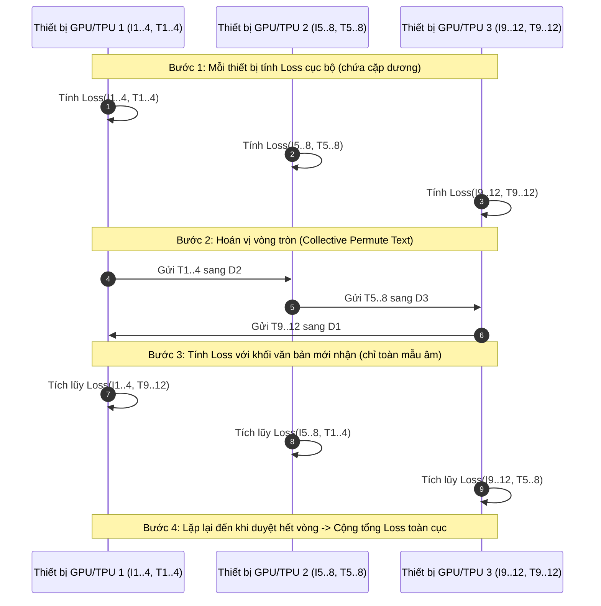

# Báo cáo Chuyên sâu: Phân tích Kiến trúc, Huấn luyện, Hàm mất mát và Đối chuẩn Toàn diện giữa OpenAI CLIP và Google SigLIP

---

## 1. Tổng quan & Bối cảnh Lịch sử (Vision-Language Evolution)

### 1.1. Lịch sử Nghiên cứu Thị giác - Ngôn ngữ trước CLIP
Trước năm 2021, các hệ thống học biểu diễn đa phương thức (Vision-Language) chủ yếu dựa trên kiến trúc hai giai đoạn phức tạp (Two-Stage Pipeline):
1. **Trích xuất đặc trưng vùng (Region Features)**: Sử dụng các mạng phát hiện đối tượng (Object Detector) tiền huấn luyện như Faster R-CNN (với khung trích xuất Bottom-Up Top-Down) để tìm kiếm các hộp giới hạn (Bounding Boxes) và trích xuất vector đặc trưng cục bộ cho từng vật thể.
2. **Hòa trộn đa phương thức (Multimodal Fusion)**: Đưa các vector vùng kết hợp với embedding từ ngữ vào một mạng Transformer tương tác chéo (Cross-Attention Transformer) như ViLBERT, LXMERT, UNITER, hay OSCAR.

**Nhược điểm chí tử của hướng tiếp cận trước CLIP**:
* **Chi phí tính toán khổng lồ**: Việc chạy Object Detector trên hàng triệu bức ảnh cực kỳ chậm, không thể mở rộng quy mô dữ liệu.
* **Giới hạn từ vựng đóng (Closed Vocabulary)**: Detector bị giới hạn trong số lượng nhãn danh mục cố định (ví dụ 80 nhãn COCO hoặc 1,600 nhãn Visual Genome), làm mất đi tính tổng quát hóa thế giới mở.
* **Không khả thi cho bài toán Large-scale Retrieval**: Do sử dụng cơ chế Cross-Attention ngay từ các tầng sớm, việc tìm kiếm 1 câu văn bản trên kho $N$ ảnh đòi hỏi phải chạy mạng Transformer $N$ lần, dẫn đến độ phức tạp tính toán không thể chấp nhận trong thực tế.

---

### 1.2. Bước ngoặt từ OpenAI CLIP (2021)
Năm 2021, công trình nghiên cứu *"Learning Transferable Visual Models From Natural Language Supervision"* (Radford et al., ICML 2021) của OpenAI đã tạo ra cuộc cách mạng với mô hình **CLIP (Contrastive Language-Image Pre-training)**:
* **Kiến trúc tháp đôi (Two-Tower / Dual-Encoder)**: Tách rời hoàn toàn bộ mã hóa hình ảnh (Image Tower) và bộ mã hóa văn bản (Text Tower). Hai tháp chỉ tương tác ở lớp cuối cùng thông qua phép nhân tích vô hướng (Dot Product).
* **Độ phức tạp $O(1)$ khi truy xuất**: Toàn bộ kho dữ liệu ảnh có thể được mã hóa ngoại tuyến (Offline) và lưu vào cơ sở dữ liệu vector. Khi có truy vấn văn bản, hệ thống chỉ cần mã hóa câu hỏi một lần và thực hiện so khớp vector qua Cosine Similarity.
* **Học từ dữ liệu web tự nhiên (WIT-400M)**: Thay vì gán nhãn thủ công tốn kém, CLIP khai thác 400 triệu cặp (ảnh, văn bản) thu thập tự do từ Internet bằng học đối chiếu (Contrastive Learning).

---

### 1.3. Sự ra đời của Google SigLIP (2023)
Mặc dù CLIP đạt thành công vang dội, kiến trúc huấn luyện dựa trên hàm mất mát InfoNCE Softmax của nó chứa đựng những giới hạn nội tại nghiêm trọng về khả năng mở rộng phần cứng và hiện tượng nhiễu ngữ nghĩa (Semantic Collision).

Tại hội nghị ICCV 2023, nhóm nghiên cứu Google DeepMind (Xiaohua Zhai, Basil Mustafa, Alexander Kolesnikov, Lucas Beyer) thuộc dự án BigVision đã xuất bản công trình *"Sigmoid Loss for Language Image Pre-Training"* (**SigLIP**):
* **Cải tiến trực tiếp từ CLIP**: SigLIP kế thừa toàn bộ triết lý tháp đôi (Dual-Encoder) của CLIP nhưng thay thế triệt để hàm mất mát Softmax bằng **Pairwise Sigmoid Loss**.
* **Độc lập hóa các cặp huấn luyện**: Chuyển bài toán so sánh phân phối đa lớp (Categorical Softmax) thành bài toán phân loại nhị phân độc lập cho từng cặp (ảnh, văn bản), giúp tối ưu hóa bộ nhớ, loại bỏ nút thắt cổ chai truyền thông giữa các thiết bị và đạt hiệu năng vượt trội.

---

## 2. Nghiên cứu Chuyên sâu về OpenAI CLIP

```mermaid
flowchart TD
    subgraph CLIP_Arch["Kiến trúc OpenAI CLIP (Dual-Encoder)"]
        subgraph Visual_Tower["Image Encoder (ViT-B/32 hoặc ResNet)"]
            RawImg["Ảnh đầu vào (224x224x3)"] --> PatchProj["Linear Patch Projection (Patch 32x32 -> 49 tokens)"]
            PatchProj --> AddCLS["Thêm [class] Token + Positional Embedding"]
            AddCLS --> ViTBlocks["12 Lớp Vision Transformer Encoder (Pre-LN)"]
            ViTBlocks --> Pool["Lấy vector đặc trưng tại [class] token"]
            Pool --> VisualProj["Visual Linear Projection -> 512D"]
            VisualProj --> NormImg["L2 Normalization: ||x|| = 1"]
        end

        subgraph Text_Tower["Text Encoder (Causal Masked Transformer)"]
            RawTxt["Chuỗi văn bản"] --> BPE["BPE Tokenizer (Vocab 49,408, Max 77)"]
            BPE --> TokEmbed["Token Embedding + Positional Embedding"]
            TokEmbed --> CausalTF["12 Lớp Transformer (Causal Attention Mask)"]
            CausalTF --> EOT["Lấy vector tại vị trí token [EOT]"]
            EOT --> TextProj["Text Linear Projection -> 512D"]
            TextProj --> NormTxt["L2 Normalization: ||y|| = 1"]
        end

        NormImg --> SimMatrix["Tích vô hướng Cosine Similarity (x · y)"]
        NormTxt --> SimMatrix
        SimMatrix --> Temp["Nhân với nhiệt độ học được: logit_scale = exp(t')"]
        Temp --> SoftmaxSym["InfoNCE Symmetric Softmax Loss (Toàn bộ Batch)"]
    end
```

### 2.1. Kiến trúc Bộ Mã hóa Hình ảnh (Vision Encoder)
CLIP cung cấp hai nhánh kiến trúc thị giác:
1. **ResNet cải tiến**: Gồm các phiên bản ResNet-50, ResNet-101, và các bản mở rộng theo tỷ lệ tính toán (RN50x4, RN50x16, RN50x64). Thay vì dùng Global Average Pooling ở tầng cuối, CLIP sử dụng cơ chế **Attention Pooling** (Query là vector học được, Key/Value là đặc trưng không gian của ResNet).
2. **Vision Transformer (ViT)**: Các phiên bản ViT-B/32, ViT-B/16, ViT-L/14, và ViT-L/14@336px:
   * **Phân chia Patch**: Ảnh kích thước $224 \times 224 \times 3$ được chia thành lưới các ô vuông kích thước $P \times P$. Với ViT-B/32, $P = 32$, tạo ra $N = (224/32) \times (224/32) = 7 \times 7 = 49$ patch tokens.
   * **Chiếu tuyến tính**: Mỗi patch kích thước $32 \times 32 \times 3 = 3,072$ giá trị pixel được chiếu qua một ma trận tuyến tính thành vector chiều $D_{\text{model}} = 768$.
   * **Token lớp học `[class]`**: Một vector học được bổ sung vào đầu chuỗi patch tokens để tổng hợp ngữ nghĩa toàn cục.
   * **Position Embedding**: Nhúng vị trí không gian 1D có thể học được cộng trực tiếp vào từng token.
   * **Transformer Blocks**: 12 tầng Transformer Encoder với chuẩn hóa Pre-LayerNorm, kích hoạt QuickGELU ($x \cdot \sigma(1.702 \cdot x)$) nhằm tăng tốc độ tính toán phần cứng so với GELU chuẩn.
   * **Chiếu không gian chung (Visual Projection)**: Vector tại vị trí token `[class]` sau khi qua LayerNorm cuối cùng được nhân với ma trận `visual_projection` $\in \mathbb{R}^{768 \times 512}$ để chuyển về không gian nhúng đa phương thức 512D.

### 2.2. Kiến trúc Bộ Mã hóa Văn bản (Text Encoder)
* **Kiến trúc Transformer**: Gồm 12 tầng Transformer với ẩn số chiều 512 và 8 attention heads. Sử dụng **Causal Attention Mask** (mỗi từ chỉ được chú ý đến các từ đứng trước nó) để tận dụng các trọng số tiền huấn luyện ngôn ngữ tự hồi quy.
* **Tokenizer Byte-Pair Encoding (BPE)**: 
  * Tập từ vựng (Vocabulary) gồm **49,408 tokens**.
  * Độ dài ngữ cảnh tối đa cố định ở **77 tokens** (bao gồm ký hiệu bắt đầu `<|startoftext|>` và kết thúc `<|endoftext|>`).
  * Các câu ngắn hơn 77 tokens được đệm (padding) bằng các token rỗng phía sau.
* **Trích xuất đặc trưng**: Vector văn bản không lấy ở vị trí đầu tiên, mà được trích xuất chính xác tại vị trí của token kết thúc câu (`<|endoftext|>`) trong chuỗi:
  $$x_{\text{text}} = \text{LayerNorm}(X)_{[\text{argmax}(\text{text})]} \times W_{\text{text\_projection}}$$
  Trong đó $W_{\text{text\_projection}} \in \mathbb{R}^{512 \times 512}$.

### 2.3. Hàm Mất Mát InfoNCE (Symmetric Softmax Contrastive Loss)
Hàm mất mát của CLIP hoạt động trên một mini-batch gồm $B$ cặp ảnh - văn bản $(I_i, T_i)$:

1. **Chuẩn hóa L2**:
   $$x_i = \frac{f(I_i)}{\|f(I_i)\|_2}, \quad y_i = \frac{g(T_i)}{\|g(T_i)\|_2} \quad \implies \|x_i\|_2 = \|y_i\|_2 = 1$$
2. **Tính toán ma trận Logits Tương đồng**:
   $$S_{ij} = t \cdot (x_i \cdot y_j)$$
   Trong đó $t = \exp(t')$ là hệ số tỉ lệ nhiệt độ (Learnable Logit Scale), được giới hạn trên ở mức $\ln(100) \approx 4.6052$ để đảm bảo tính ổn định số học.
3. **Mục tiêu mất mát Đối xứng (Symmetric Cross-Entropy)**:
   Mô hình tối ưu hóa đồng thời hai chiều phân loại xác suất:
   * **Chiều Hình ảnh sang Văn bản (Image-to-Text)**:
     $$L_{i2t} = -\frac{1}{B} \sum_{i=1}^B \log \frac{\exp(t \cdot x_i \cdot y_i)}{\sum_{j=1}^B \exp(t \cdot x_i \cdot y_j)}$$
   * **Chiều Văn bản sang Hình ảnh (Text-to-Image)**:
     $$L_{t2i} = -\frac{1}{B} \sum_{i=1}^B \log \frac{\exp(t \cdot x_i \cdot y_i)}{\sum_{j=1}^B \exp(t \cdot x_j \cdot y_i)}$$
   * **Hàm mất mát tổng thể**:
     $$L_{\text{CLIP}} = \frac{L_{i2t} + L_{t2i}}{2}$$

### 2.4. Các Nút thắt Cổ chai (Bottlenecks) Bản chất của CLIP
1. **Hiện tượng Va chạm Ngữ nghĩa (Semantic Collision)**:
   Phép biến đổi Softmax ép buộc tổng xác suất $\sum_{j=1}^B p_{ij} = 1$. Mẫu số của hàm Softmax xem mọi mẫu $j \neq i$ đều là mẫu âm tính (Negative). Khi kích thước batch lớn ($B = 32,768$), khả năng cao xuất hiện nhiều ảnh có cùng ngữ cảnh (ví dụ: nhiều ảnh khác nhau về cảnh biển). Softmax ép mô hình phải triệt tiêu điểm số của các ảnh cùng chủ đề, tạo ra gradient nhiễu loạn phá hỏng sự liên tục của không gian biểu diễn.
2. **Rào cản Băng thông Giao tiếp (All-Gather Hardware Bottleneck)**:
   Để tính toán được tổng mẫu số $\sum_{j=1}^B \exp(S_{ij})$, mỗi GPU trong cụm phân tán bắt buộc phải gom đủ toàn bộ embedding của tất cả các GPU khác qua lệnh `All-Gather`. Chi phí truyền thông mạng này tăng phi mã theo số lượng GPU và kích thước batch.
3. **Độ phức tạp Bộ nhớ Bậc hai $O(B^2)$**:
   Ma trận tương đồng $B \times B$ bắt buộc phải được vật lý hóa trong bộ nhớ GPU, làm cạn kiệt VRAM khi cố gắng mở rộng batch size lên trên 65,536.
4. **Cắt cụt Từ vựng Đa ngôn ngữ (Token Truncation)**:
   Tokenizer BPE 49k tokens của CLIP được tối ưu riêng cho tiếng Anh. Đối với các ngôn ngữ có dấu hoặc ký tự tượng hình như tiếng Việt hoặc tiếng Trung, một từ bị bẻ nhỏ thành rất nhiều subword tokens. Khi vượt quá ngưỡng 77 tokens, thông tin nửa sau của câu bị vứt bỏ hoàn toàn.

---

## 3. Nghiên cứu Chuyên sâu về Google SigLIP

```mermaid
flowchart TD
    subgraph SigLIP_Arch["Kiến trúc Google SigLIP (BigVision)"]
        subgraph SigLIP_Visual["Image Encoder (ViT-B/16, ViT-So400m)"]
            S_RawImg["Ảnh đầu vào (224x224x3)"] --> S_Patch["Patch 16x16 -> 196 tokens (Gấp 4 lần chi tiết)"]
            S_Patch --> S_ViT["Transformer Encoder Blocks (LayerNorm chuẩn)"]
            S_ViT --> S_MAP["Multi-head Attention Pooling (MAP) hoặc CLS"]
            S_MAP --> S_VisualProj["Linear Projection -> 768D"]
            S_VisualProj --> S_NormImg["L2 Normalization: ||x|| = 1"]
        end

        subgraph SigLIP_Text["Text Encoder (Multilingual Transformer)"]
            S_RawTxt["Văn bản đa ngôn ngữ (100+ thứ tiếng)"] --> S_SPM["WebLI SentencePiece Tokenizer (Vocab 250,000)"]
            S_SPM --> S_TF["Transformer Text Blocks (Không bị cắt cụt)"]
            S_TF --> S_EOT["Pooling Representation"]
            S_EOT --> S_TextProj["Linear Projection -> 768D"]
            S_TextProj --> S_NormTxt["L2 Normalization: ||y|| = 1"]
        end

        S_NormImg --> SigDot["Tích vô hướng Tương đồng x · y"]
        S_NormTxt --> SigDot
        SigDot --> LinearScale["Nhân tỉ lệ và cộng Bias: z = t*(x · y) + b"]
        LinearScale --> PairwiseSigmoid["Pairwise Sigmoid Loss (Phân loại Nhị phân Độc lập)"]
        PairwiseSigmoid --> NoGather["Tối ưu hóa vòng tròn Ring Permute (Không cần All-Gather)"]
    end
```

### 3.1. Bối cảnh & Mục tiêu Đột phá
SigLIP được thiết kế nhằm mục tiêu: **Loại bỏ hoàn toàn phép chuẩn hóa Softmax toàn cục**, đưa bài toán học biểu diễn đa phương thức về đúng bản chất của phép phân loại nhị phân độc lập trên từng cặp dữ liệu, từ đó giải phóng mô hình khỏi các ràng buộc phần cứng.

### 3.2. Kiến trúc Mô hình
* **Bộ mã hóa Thị giác (Vision Encoder)**:
  * Backbone chính: Vision Transformer **ViT-B/16** (độ phân giải patch $16 \times 16$), **ViT-L/16**, và kiến trúc tối ưu hình học **ViT-So400m/14**.
  * Với cùng kích thước $224 \times 224$, patch 16x16 tạo ra $14 \times 14 = \mathbf{196}$ patch tokens (nhiều gấp 4 lần so với 49 tokens của CLIP ViT-B/32).
  * Sử dụng cơ chế Multi-Head Attention Pooling (MAP) để tổng hợp đặc trưng không gian đa điểm sắc nét hơn.
  * Chiều không gian nhúng: **768D Float32** (tăng 50% dung lượng biểu diễn so với 512D của CLIP).
* **Bộ mã hóa Văn bản & Tokenizer Đa ngôn ngữ**:
  * Sử dụng tokenizer **SentencePiece Unigram** được huấn luyện trên tập WebLI với kích thước bộ từ vựng khổng lồ: **250,000 tokens**.
  * Hỗ trợ tự nhiên hơn 100 ngôn ngữ toàn cầu. Các từ tiếng Việt phức tạp được mã hóa nguyên vẹn thay vì bị băm nát thành từng byte đơn lẻ.
  * Độ dài ngữ cảnh 64 tokens của SigLIP chứa được lượng ngữ nghĩa tương đương hơn 120 tokens của tokenizer CLIP BPE.

### 3.3. Hàm Mất Mát Đột phá: Pairwise Sigmoid Loss
Thay vì tính xác suất cạnh tranh Softmax trên toàn hàng và toàn cột, SigLIP định nghĩa hàm mất mát trực tiếp trên từng cặp $(I_i, T_j)$:

$$L_{\text{SigLIP}} = -\frac{1}{B} \sum_{i=1}^B \sum_{j=1}^B \log \sigma \Big( z_{ij} \big( t \cdot (x_i \cdot y_j) + b \big) \Big)$$

Triển khai chi tiết dưới dạng tổng xác suất đối số:
$$L_{\text{SigLIP}} = -\frac{1}{B} \sum_{i=1}^B \sum_{j=1}^B \log \left( \frac{1}{1 + \exp\big(-z_{ij} (t \cdot x_i \cdot y_j + b)\big)} \right)$$

Trong đó:
* $x_i, y_j \in \mathbb{R}^{768}$ là các vector đặc trưng đã chuẩn hóa chuẩn L2 $\|x_i\|_2 = \|y_j\|_2 = 1$.
* $z_{ij} \in \{-1, +1\}$ là ma trận nhãn mục tiêu nhị phân:
  $$z_{ij} = \begin{cases} +1 & \text{khi } i = j \quad (\text{Cặp dương tính: Ảnh và chú thích tương ứng}) \\ -1 & \text{khi } i \neq j \quad (\text{Cặp âm tính: Ảnh và chú thích không tương ứng}) \end{cases}$$
* $t = \exp(t')$ là hệ số nhiệt độ học được (Learnable Temperature). Khởi tạo với $t' = \ln(10) \implies t = 10$.
* $b$ là hệ số độ lệch học được (**Learnable Bias**). Khởi tạo với $b = -10$.

### 3.4. Vai trò Toán học Quyết định của Tham số Bias $b = -10$
Khám phá mang tính then chốt của Zhai et al. trong bài báo SigLIP là việc phát hiện ra vai trò của tham số bias $b$:
* Trong một mini-batch kích thước $B$, số lượng mẫu dương chỉ là $B$, trong khi số lượng mẫu âm là $B(B-1)$. Tỷ lệ mất cân bằng dữ liệu cực kỳ khốc liệt:
  $$\text{Tỷ lệ Âm : Dương} = (B - 1) : 1$$
  Với $B = 32,768$, cứ 1 mẫu dương thì có tới 32,767 mẫu âm!
* Nếu không có bias $b$ (tức $b = 0$), tại thời điểm khởi tạo ngẫu nhiên, tích vô hướng $x_i \cdot y_j \approx 0$, hàm sigmoid sẽ cho ra giá trị:
  $$\sigma(0) = 0.5$$
  Điều này đồng nghĩa mô hình dự đoán mọi cặp âm đều có 50% khả năng là cặp dương. Tổng loss của hàng trăm triệu cặp âm sẽ bùng nổ, triệt tiêu hoàn toàn gradient của các cặp dương và làm sụp đổ quá trình hội tụ.
* **Giải pháp của SigLIP**: Khởi tạo $b = -10$. Khi đó, tại bước lặp đầu tiên:
  $$\sigma(b) = \sigma(-10) = \frac{1}{1 + e^{10}} \approx 0.0000454$$
  Xác suất dự đoán ban đầu này khớp hoàn hảo với xác suất tiên nghiệm ngẫu nhiên của một cặp dương ($1 / 32,768 \approx 0.0000305$). Nhờ đó, gradient xuất phát điểm ở trạng thái cân bằng tuyệt đối, giúp mô hình ổn định ngay từ step đầu tiên mà không cần bất kỳ thủ thuật cân bằng trọng số hay negative sampling nào.

---

### 3.5. Đột phá Tối ưu Phần cứng: Ring Collective Permute (Loại bỏ All-Gather)
Một trong những lý do khiến SigLIP có thể mở rộng batch size lên tới **1,000,000** nằm ở cơ chế streaming ma trận mất mát:

* **Không cần All-Gather**: Do không có mẫu số Softmax chung, từng thiết bị chỉ cần giữ cố định batch ảnh của mình và cho dòng chảy văn bản (text representations) di chuyển vòng tròn qua các thiết bị.
* **Bộ nhớ chỉ $O(b^2)$ thay vì $O(B^2)$**: Bộ nhớ GPU tại bất kỳ thời điểm nào chỉ cần chứa một khối nhỏ kích thước $b \times b$ (với $b$ là kích thước batch trên một chip đơn lẻ), hoàn toàn độc lập với kích thước tổng thể $B$ của toàn mạng.

---

## 4. So sánh Tổng hợp Đối đầu: CLIP vs SigLIP

Dưới đây là bảng đối chiếu kỹ thuật đa chiều giữa hai mô hình:

| Tiêu chí So sánh | OpenAI CLIP (Radford et al., 2021) | Google SigLIP (Zhai et al., 2023) | Ý nghĩa Khoa học & Thực tiễn |
| :--- | :--- | :--- | :--- |
| **Bản chất Hàm Mất Mát** | **InfoNCE Softmax** (Categorical Cross-Entropy) | **Pairwise Sigmoid** (Binary Logistic Regression) | SigLIP độc lập hóa từng cặp, không phụ thuộc phân phối batch |
| **Phương thức Chuẩn hóa** | Toàn cục trên toàn bộ Batch ($\sum_j \exp(S_{ij})$) | Không chuẩn hóa mẫu số (Mỗi cặp tính độc lập) | Loại bỏ hoàn toàn sự cạnh tranh giả định giữa các mẫu |
| **Hiện tượng Semantic Collision** | **Nghiêm trọng** khi batch size lớn ($B \ge 16k$) | **Triệt tiêu hoàn toàn** (0% Collision) | Cho phép các ảnh có cùng nội dung cùng nhận điểm cao |
| **Yêu cầu Băng thông Mạng** | Bắt buộc `All-Gather` toàn bộ embedding | `Ring Collective Permute` tuần tự từng phần | Giảm áp lực nghẽn mạng liên chip (inter-node bandwidth) |
| **Bộ nhớ VRAM Tiêu thụ** | $O(B^2)$ (Bắt buộc giữ toàn ma trận) | $O(b^2)$ (Chỉ cần giữ ma trận khối cục bộ) | Cho phép SigLIP mở rộng batch lên 1,000,000 |
| **Độ nhạy Batch Size Nhỏ** | Rất kém ở batch nhỏ ($B \le 8k$), cần batch cực lớn | **Rất tốt ở batch nhỏ** ($B = 1k, 2k, 4k$) | Dễ huấn luyện và fine-tune trên tài nguyên vừa phải |
| **Cơ chế Tham số** | Chỉ có nhiệt độ $t$ ($t \le 100$) | Có cả nhiệt độ $t$ và **Bias $b$** (khởi tạo $-10$) | Bias giải quyết bài toán mất cân bằng âm/dương cực đoan |
| **Bộ từ vựng (Vocabulary)** | BPE 49,408 tokens (Tiếng Anh là trọng tâm) | SentencePiece 250,000 tokens (Đa ngôn ngữ 100+) | SigLIP vượt trội trên tiếng Việt, tiếng Trung, đa ngữ |
| **Độ dài Ngữ cảnh** | Cố định cứng 77 tokens (Cắt cụt nếu dài hơn) | 64 tokens (Nén ngữ nghĩa cao gấp đôi nhờ từ vựng lớn) | Tránh mất mát thông tin đối với các đoạn tin tức dài |
| **Kích thước Patch (ViT-B)** | $32 \times 32$ (49 visual tokens) | $16 \times 16$ (196 visual tokens) | SigLIP nắm bắt chi tiết vật thể nhỏ gấp 4 lần |
| **Không gian Biểu diễn** | **512D Float32** | **768D Float32** | SigLIP lưu trữ dung lượng ngữ nghĩa lớn hơn +50% |

---

## 5. Tác động của Khác biệt Bản chất đến Bài toán Semantic Search

Khi chuyển từ giai đoạn tiền huấn luyện sang ứng dụng thực tế trong hệ thống **Semantic Information Retrieval (Text-to-Image / Text-to-Video)**, các khác biệt trên dẫn đến sự thay đổi rõ rệt trong hành vi tìm kiếm:

### 5.1. Phân phối Điểm số và Thiết lập Ngưỡng (Score Calibration)
* **Trong CLIP**: Do Softmax trong lúc huấn luyện ép các khoảng cách phải rất sắc nhọn ($\tau \approx 0.01$), các điểm số Cosine Similarity suy luận thường bị dồn về khoảng $0.20 - 0.35$. Điểm số này mang tính chất tương đối (relative ranking) trong một tập cố định hơn là một xác suất tuyệt đối, gây khó khăn cho việc đặt ngưỡng lọc (Thresholding) cứng xuyên suốt các chủ đề khác nhau.
* **Trong SigLIP**: Hàm mất mát nhị phân huấn luyện mô hình dự đoán xác suất độc lập:
  $$P(\text{Khớp}) = \sigma(t \cdot (x \cdot y) + b)$$
  Không gian embedding của SigLIP phản ánh trực tiếp độ tin cậy phân loại nhị phân. Điểm số tương đồng mượt mà và tuyến tính hơn, giúp việc thiết lập bộ lọc chất lượng kết quả trong hệ thống tìm kiếm đạt độ ổn định cao.

### 5.2. Giải quyết Bài toán Nhiều Kết quả Phù hợp (Multi-Positive Retrieval)
Trong thực tế tìm kiếm ngữ nghĩa, một câu truy vấn tổng quát như *"Tổng thống phát biểu tại bục họp báo"* sẽ có hàng chục hoặc hàng trăm video/ảnh trong cơ sở dữ liệu thỏa mãn đầy đủ ngữ nghĩa này:
* **Hạn chế của CLIP**: Do trong quá trình tiền huấn luyện, nếu hai ảnh họp báo cùng xuất hiện trong một mini-batch, CLIP bắt buộc phải dìm điểm của một trong hai ảnh xuống để tối ưu hóa hàm Softmax. Do đó, không gian nhúng của CLIP có xu hướng bị phân mảnh, một số ảnh đúng nhưng vẫn bị xếp hạng rất thấp vì mang đặc trưng tương tự các mẫu âm giả (False Negatives).
* **Ưu thế của SigLIP**: SigLIP coi mỗi cặp ảnh - văn bản là một bài toán nhị phân độc lập. Hai bức ảnh cùng thể hiện một sự kiện họp báo đều có thể đồng thời đạt điểm tương đồng cực cao mà không triệt tiêu lẫn nhau. Điều này giải thích tại sao trên tập dữ liệu thời sự **NewsSeek**, Recall@10 và MRR của SigLIP liên tục dẫn đầu.

### 5.3. Độ nhạy với Truy vấn Chi tiết & Yếu tố Quan hệ (Fine-grained & Relational Queries)
* Nhờ độ phân giải patch $16 \times 16$ (196 patch tokens so với 49 của CLIP ViT-B/32), SigLIP bảo toàn vị trí không gian của các vật thể nhỏ (ví dụ: chiếc micro trên bục, chiếc cà vạt màu đỏ, tấm biển số xe xa).
* Trong các truy vấn có yếu tố quan hệ không gian phức tạp (ví dụ: *"chó nằm dưới ghế gỗ"* thay vì chỉ *"chó và ghế"*), SigLIP có đủ tokens không gian để mã hóa mối quan hệ tương hỗ giữa hai đối tượng, trong khi CLIP ViT-B/32 thường gộp chung cả hai vật thể vào một vài patch $32 \times 32$ bị nhòe đặc trưng.

### 5.4. Khả năng Truy xuất Đa ngôn ngữ (Multilingual Search)
* Khi thử nghiệm với câu truy vấn tiếng Việt trên tập dữ liệu NewsSeek:
  * CLIP sử dụng BPE tiếng Anh: Một từ như *"người đi xe máy"* bị chia nhỏ thành chuỗi nhiều ký tự lẻ, gây suy hao vector ngữ nghĩa nghiêm trọng.
  * SigLIP sử dụng SentencePiece WebLI 250k: Toàn bộ cụm từ ngữ tiếng Việt được ánh xạ thành các token nguyên khối, bảo toàn nguyên vẹn tính định hướng ngữ nghĩa trong không gian đa phương thức.

---

## 6. Kết luận

1. **Về mặt Lý thuyết**: SigLIP không phải là một nhánh kiến trúc độc lập xa lạ, mà là **bước tiến hóa trực tiếp, có chủ đích và có tính kế thừa sâu sắc từ OpenAI CLIP**. SigLIP đã nhận diện chính xác điểm nghẽn toán học lớn nhất của CLIP (Softmax normalization) và thay thế nó bằng giải pháp Pairwise Sigmoid Loss thanh lịch, hiệu quả hơn cả về mặt lý thuyết xác suất lẫn kỹ thuật tính toán song song.
2. **Về mặt Ứng dụng Thực tiễn (Semantic Search)**: Sự kết hợp giữa **Pairwise Sigmoid Loss**, **Patch resolution $16 \times 16$**, **Embedding 768D**, và **Tokenizer SentencePiece 250k** giúp Google SigLIP vượt trội toàn diện so với OpenAI CLIP trên cả dữ liệu ảnh chuẩn tắc (MS COCO) lẫn dữ liệu video đa ngôn ngữ thực tế (NewsSeek).
